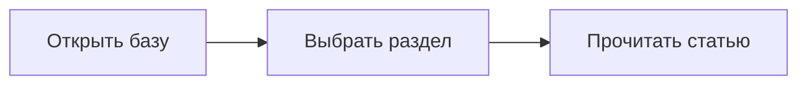

# Доступные элементы оформления контента

## 1. Заголовки

Ниже — шесть уровней заголовков. В обычной статье H1 используется один раз — для названия страницы.

# Заголовок первого уровня

## Заголовок второго уровня

### Заголовок третьего уровня

#### Заголовок четвёртого уровня

##### Заголовок пятого уровня

###### Заголовок шестого уровня

Заголовок альтернативного синтаксиса H2
--------------------------------------

## 2. Абзацы и переносы строк

Первый абзац. Он содержит несколько предложений, чтобы оценить межстрочный интервал и расстояния между блоками. Текст должен оставаться удобным для чтения как на широком экране, так и на телефоне.

Второй абзац отделён пустой строкой.

Эти две строки разделены обычным переводом строки в исходнике,
но отображаются одним абзацем — это мягкий перенос Markdown.

После этой строки стоят два пробела.  
Поэтому здесь начинается новая строка без нового абзаца.

После этой строки стоит обратная косая черта.\
Это ещё один способ принудительного переноса.

Здесь используется HTML-тег `<br>`:<br>новая строка внутри абзаца.

## 3. Выделение и специальные символы

**Жирный текст**, *курсив*, ***жирный курсив***, ~~зачёркнутый текст~~, **жирный текст с _курсивом внутри_** и `код внутри строки`.

Альтернативные маркеры: __жирный__ и _курсив_.

Экранирование: \*это не курсив\*, \# это не заголовок, \[это не ссылка\], \`это не код\`.

Символы HTML: &copy; &mdash; &rarr; &nbsp; &lt; &gt; &amp;.

Unicode и эмодзи: → ← ↗ · — «кавычки» ✅ ⚠️ 🚙.

## 4. Ссылки и якоря

- [Внешняя ссылка на репозиторий](https://github.com/iworkup/monjaro "Открыть репозиторий").
- [Ссылка через определение][repo].
- Автоматическая ссылка: https://github.com/iworkup/monjaro
- Ссылка в угловых скобках: <https://github.com/iworkup/monjaro>
- Пример адреса электронной почты: <example@example.com>
- [Внутренняя страница базы](#/articles).
- [Переход к разделу с таблицами](#7-таблицы).
- Длинная ссылка для проверки переноса: https://example.com/very-long-path/another-section/knowledge-base/testing-responsive-layout-with-long-addresses?parameter=long-value&language=ru

[repo]: https://github.com/iworkup/monjaro "Репозиторий проекта"

## 5. Списки

### Маркированный

- Первый пункт.
- Второй пункт с **выделением**.
  - Вложенный пункт.
    - Третий уровень.
  - Ещё один вложенный пункт.
- Последний пункт.

### Нумерованный

1. Откройте раздел.
2. Выберите статью.
   1. Прочитайте описание.
   2. Проверьте дату и источник.
3. Вернитесь к оглавлению.

### Начало с другого номера

7. Седьмой пункт.
8. Восьмой пункт.

### Смешанный список и несколько абзацев

1. Первый шаг.

   Дополнительный абзац внутри того же шага.

   - Вариант А.
   - Вариант Б.

2. Второй шаг.

### Список задач GFM

- [x] Создать шаблон.
- [x] Проверить отображение Markdown.
- [ ] Перенести проверенные материалы.
  - [x] Подготовить структуру.
  - [ ] Наполнить разделы.

Чекбоксы показывают состояние из файла и не изменяются при нажатии.

## 6. Цитаты и уведомления

> Обычная цитата из одного абзаца.
>
> Второй абзац той же цитаты с **выделением** и [ссылкой][repo].
>
> > Вложенная цитата.

> Цитата со списком:
> - Первый пункт.
> - Второй пункт.

> [!NOTE]
> Дополнительная информация, которую полезно учесть.

> [!TIP]
> Совет, который помогает выполнить действие удобнее.

> [!IMPORTANT]
> Важное условие для понимания материала.

> [!WARNING]
> Предупреждение о возможной проблеме.

> [!CAUTION]
> Действие требует особого внимания.

## 7. Таблицы

| Элемент | Назначение | Статус |
| :--- | :---: | ---: |
| **Статья** | Подробное описание | Готово |
| `SUMMARY.md` | Оглавление | В планах |
| [Репозиторий][repo] | Исходные файлы | Доступен |
| Вертикальная черта \| | Экранирование | Проверка |
| Первая строка<br>Вторая строка | HTML-перенос | Проверка |

### Широкая таблица

Эта таблица должна прокручиваться горизонтально внутри своего блока, не растягивая всю страницу.

| Раздел | Подраздел | Версия системы | Комплектация | Источник информации | Дата проверки | Результат |
| --- | --- | --- | --- | --- | --- | --- |
| Электроника | Мультимедиа | Демонстрационная версия 1.0 | Демонстрационная комплектация | Тестовый пример без технических рекомендаций | 20.10.2026 | Требует проверки |
| Приложения | Инструменты | Демонстрационная версия 2.0 | Другая комплектация | Ещё один пример длинного содержимого ячейки | 20.10.2026 | Черновик |

## 8. Код

Внутри строки: `const model = "Geely Monjaro";`.

Если внутри кода есть обратная кавычка: ``текст с ` символом``.

### Блок с указанием языка

```javascript
const article = {
  title: 'Geely Monjaro',
  checked: false
};

function showTitle(item) {
  return item.title;
}
```

### JSON

```json
{
  "title": "База знаний",
  "sections": ["FAQ", "Статьи", "Приложения"]
}
```

### Без языка и длинная строка

```
Очень длинная строка кода для проверки горизонтальной прокрутки: /articles/electronics/media/unit/settings/profiles/driver/options/save/restore/another/long/example
```

### Блок с отступом в четыре пробела

    Первая строка блока с отступом.
    Вторая строка блока с отступом.

### Ограда из тильд

~~~text
Ещё один допустимый синтаксис блока кода.
~~~

Код пока оформляется без подсветки синтаксиса; указание языка сохраняется в HTML.

## 9. Изображения


*Подпись обычным курсивным абзацем. Изображение масштабируется по ширине статьи.*

Картинка-ссылка:

[][repo]

## 10. Разделители

Текст до разделителя.

---

Текст между разделителями.

***

Текст после второго разделителя.

## 11. HTML внутри Markdown

GitHub допускает ограниченный набор HTML. Здесь HTML очищается от скриптов и небезопасных атрибутов.

<details>
<summary>Раскрывающийся блок — нажмите, чтобы открыть</summary>

Внутри раскрывающегося блока работают **Markdown**, абзацы и списки.

- Первый пункт.
- Второй пункт.

</details>

Комбинация клавиш: <kbd>Ctrl</kbd> + <kbd>K</kbd>.

Подстрочный индекс: H<sub>2</sub>O. Надстрочный индекс: м<sup>2</sup>.

<ins>Вставленный текст</ins> и <del>удалённый текст</del>.

<!-- Этот комментарий не должен отображаться. -->

## 12. Сноски

Предложение с первой сноской.[^first]

Другая сноска с несколькими абзацами.[^long]

Повторная ссылка на первую сноску.[^first]

[^first]: Источник или пояснение к предложению.
[^long]: Первый абзац длинной сноски.

    Второй абзац с **выделением** и [ссылкой][repo].

## 13. Возможности интерфейса GitHub

Следующие возможности GitHub не входят в базовый GFM. Пока они показаны как исходный синтаксис и не преобразуются в виджеты.

### Математические формулы — пока без рендеринга

```markdown
Внутри строки: $E = mc^2$.

$$
\frac{a}{b} = \sqrt{x}
$$
```

### Mermaid — пока без рендеринга



### Специальные блоки GitHub — пока без рендеринга

```geojson
{"type":"Point","coordinates":[37.6173,55.7558]}
```

```stl
solid demo
endsolid demo
```

### Упоминания, номера задач и короткие коды эмодзи

`@iworkup`, `#123`, `:warning:` — GitHub преобразует их в контексте своего интерфейса. Здесь они остаются обычным текстом. Unicode-эмодзи работают: ⚠️.

## 14. Проверка длинных слов

ДемонстрационноеОченьДлинноеСловоБезПробеловДляПроверкиАдаптивногоОтображенияНаУзкомЭкранеИОтсутствияГоризонтальнойПрокрутки.

## Источники

- [Спецификация GitHub Flavored Markdown](https://github.github.com/gfm/).
- [Документация по оформлению на GitHub](https://docs.github.com/en/get-started/writing-on-github).
